# kaggle-timeseries

Sequence and time-series projects from Kaggle competitions. Each project has its own folder with its code, tests, logs and
figures, and its own detailed README.

| Folder | Competition | Task | Best result |
| --- | --- | --- | --- |
| [`rogii-wellbore-geology/`](rogii-wellbore-geology/) | [ROGII Wellbore Geology Prediction](https://www.kaggle.com/competitions/rogii-wellbore-geology-prediction) (2026) | Predict the stratigraphic depth (TVT) of a horizontal well beyond the last interpreted point, from gamma ray, trajectory and a vertical type well | **RMSE 11.622 public / 11.980 private (ft)** |
| [`enefit-prosumer-energy/`](enefit-prosumer-energy/) | [Enefit - Predict Energy Behavior of Prosumers](https://www.kaggle.com/competitions/predict-energy-behavior-of-prosumers) (2023-24) | Day-ahead hourly solar production and consumption of 69 prosumer segments, from weather forecasts, capacity and a two-day-delayed target history | **MAE 56.6 kWh back-test** (not scored on Kaggle) |
| [`optiver-realized-volatility/`](optiver-realized-volatility/) | [Optiver Realized Volatility Prediction](https://www.kaggle.com/competitions/optiver-realized-volatility-prediction) (2021-22) | Realised volatility of the next ten minutes of 112 stocks, from one-second order-book and trade data of the current window | **RMSPE 0.2057 local report**; Kaggle private 0.24597 (late submission; the public column shows an implausible 0.0, see below) |
| [`m5-forecasting-accuracy/`](m5-forecasting-accuracy/) | [M5 Forecasting - Accuracy](https://www.kaggle.com/competitions/m5-forecasting-accuracy) (2020) | Daily unit sales of 30,490 item-store series for the next 28 days, scored by WRMSSE over 12 aggregation levels, from calendar, SNAP days and prices | **WRMSSE 0.67907 public / 0.60711 private** (late submission) |

---

## ROGII wellbore geology: 2-D candidate-grid U-Nets with a row-level stack

### The problem

A horizontal well is drilled through layered rock. Along the well we know the measured depth (MD), the position
(X, Y, Z) and a gamma-ray log (GR). Each well comes with a nearby vertical **type well**, which gives GR as a function of
true vertical thickness (TVT), a depth coordinate that follows the layers. Interpreters have labelled TVT up to some
point of each horizontal well. The task is to predict TVT for every row after that point, which we call the **cut**.
The score is the root mean squared error pooled over all predicted rows, in feet.

Doing nothing already sets a strong baseline: the **carry-forward** prediction (repeat the last known TVT) scores
15.71 ft on our report folds. Every model below is judged by how far it gets below that baseline.

### Disclaimer on compute

> Everything ran on **low-tier hardware: one GPU at a time**.
>
> - Round 1 sequence models (GRU-D, SSM): one **NVIDIA T4**.
> - Final U-Nets: one **NVIDIA L4**, a T4-class card.
> - Trackers and gradient boosting: a multi-core CPU.
>
> The submitted pipeline used about **1.7 GPU-hours** of training: 15 cross-validation runs plus 3 full-data runs of
> 12 epochs each, logged in [`results/training/`](rogii-wellbore-geology/results/training/). The final U-Nets have
> 0.5 M to 2.1 M parameters. Top leaderboard solutions use far more compute, more seeds, longer schedules and
> synthetic-well pre-training. For this budget, a private score of 11.98 ft is a decent result, not a state-of-the-art
> one. Out-of-fold, the submitted model is 17 % below carry-forward.

### Leaderboard

<p align="center"></p>

| Submission | What it is | Out-of-fold, folds 2-5 | Out-of-fold, all folds | Public | Private |
| --- | --- | --- | --- | --- | --- |
| `rogii-grid-unet-b` | 3-width U-Net snapshot blend + gradient-boosted margin | 13.070 | 13.296 | **11.622** | **11.980** |
| `rogii-grid-unet-a` | 3-width U-Net snapshot blend | 13.270 | 13.453 | 12.008 | 12.180 |

These are code-competition submissions: a Kaggle notebook ([`notebooks/inference.ipynb`](rogii-wellbore-geology/notebooks/inference.ipynb))
loads frozen checkpoints and predicts the hidden test wells. Both were scored after the competition deadline. Sources:
[`results/leaderboard.csv`](rogii-wellbore-geology/results/leaderboard.csv) and
[`results/stack/stack_log.jsonl`](rogii-wellbore-geology/results/stack/stack_log.jsonl).

### Experiment history: what failed before the submission

Most attempts failed. A model counts as useful only if it beats **carry-forward** on the same rows, because simply
repeating the last known TVT is a strong baseline (15.71 ft on folds 2-5, 16.75 ft on fold 1). Each experiment below
was scored on held-out wells under fixed fold roles: fold 1 for choices, folds 2-5 for reporting. The table includes
every attempt, including the abandoned ones.

<p align="center"></p>
<p align="center"><sub>Every scored experiment as a ratio to carry-forward on the same rows (below 1 is better). Source: <code>results/history/experiments.csv</code>.</sub></p>

| # | Round | Experiment | Scored on | RMSE (ft) | Carry (ft) | Outcome |
| --- | --- | --- | --- | --- | --- | --- |
| E1 | 1 | Carry-forward | folds 2-5 | 15.71 | 15.71 | reference |
| E2 | 1 | Linear extrapolation of TVT in MD | 4-well smoke test | 65.77 | 11.88 | failed: drifts off quickly |
| E3 | 1 | LightGBM on per-row features | folds 2-5 | 16.24 | 15.71 | **worse than carry** |
| E4 | 1 | GRU-D-style seq2seq (T4) | fold 1 | 16.53 | 16.75 | barely better |
| E5 | 1 | Companion-matrix state-space model (T4) | fold 1 | 18.43 | 16.75 | **worse than carry** |
| E6 | 2 | Geometric extrapolation of TVT (best of 9 variants) | fold 1 | 57.52 | 16.75 | failed |
| E7 | 3 | Grid tracker V1 (exact Bayesian) | folds 2-5 | 16.92 | 15.71 | **worse than carry**: locks onto wrong layers |
| E8 | 3 | Grid tracker V2 (multi-scale emission) | folds 2-5 | 17.38 | 15.71 | **worse than carry** |
| E9 | 3 | Tracker with learned (LightGBM) emission | fold 1 smoke | AUC 0.896 | - | abandoned before tracking |
| E10 | 3 | Coarsened tracker | folds 2-5 | 14.46 | 15.71 | first win over carry |
| E11 | 3 | Optimal-transport (W2) window tracker | fold 1 | 46.33 | 16.75 | failed |
| E12 | 3 | Multi-hypothesis net chained with a beam | fold 1 | 21.11 | 16.75 | failed |
| E13 | 3 | Fusion of E10-E12 | - | - | - | not run (two of three parts failed) |
| E14 | 4 | 1-D residual U-Nets with iterative cost volume | fold 1 | 15.71 | 16.75 | small gain |
| E15 | 4 | Block-level LightGBM base | folds 1-5 | block metric only | - | superseded |
| E16 | 5 | Grid U-Net, widths 16+24, plus LightGBM margin | folds 2-5 | 13.16 | 15.71 | superseded by three widths |
| E17 | 5 | Grid U-Net, 3 widths, plus XGBoost (GPU) margin | folds 2-5 | 13.67 | 15.71 | margin overfit |
| **E18** | 5 | **A: grid U-Net snapshot blend, 3 widths** | folds 2-5 | **13.27** | 15.71 | **submitted: 12.180 private** |
| **E19** | 5 | **B: A + LightGBM margin** | folds 2-5 | **13.07** | 15.71 | **submitted: 11.980 private (best)** |
| E20 | 5 | B with a per-well A/B gate | folds 2-5 | 13.18 | 15.71 | not better than B |
| E21 | 5 | Gate + scale direction | folds 2-5 | 13.18 | 15.71 | not better than B |

Sources: [`results/history/`](rogii-wellbore-geology/results/history/), [`results/baselines/`](rogii-wellbore-geology/results/baselines/)
and [`results/stack/`](rogii-wellbore-geology/results/stack/). E2 is a mean of per-well RMSEs; every other number is a
pooled row RMSE. Fold 1 numbers come from the fold used for choices, so they are slightly optimistic.

**What each round taught the next one.**

1. **Generic forecasters fail** (E2-E5). Predicting TVT from the well's own recent history ignores the only real
   evidence, the match between the well's GR and the type well. Errors grow with distance from the cut, and the
   models end up close to carry-forward.
2. **Pure geometry fails** (E6). Extrapolating TVT linearly in X, Y, Z or MD amplifies small slope errors over
   thousands of rows.
3. **Exact Bayesian tracking is overconfident** (E7-E8). Thousands of correlated GR samples are treated as independent
   evidence. The posterior collapses onto one layer, which is often wrong where layers repeat. Coarsening the
   likelihood (E10) fixed the overconfidence and gave the first gain. More expressive likelihoods (E11 optimal
   transport, E12 multi-hypothesis net) were worse.
4. **Learned 1-D models help a little** (E14). A 1-D U-Net with a local cost volume only sees a narrow window of
   candidate depths around its current estimate. When the estimate drifts, the right layer leaves the window.
5. **The 2-D image formulation works** (E16-E21). The model sees every candidate depth (±96 ft) at once for the whole
   suffix, alongside the known history and a constant-dip prior. It then decodes an expected value, which is what
   RMSE rewards. A gradient-boosted margin trained on out-of-fold errors adds a little. Extra stack levels (gate,
   scale direction) did not generalise.

### Methodologies

Every method (E1-E21), with input, model, output and outcome: [`rogii-wellbore-geology/docs/methodologies.md`](rogii-wellbore-geology/docs/methodologies.md).

### Key mathematical points

**1. The target is a slowly varying surface minus depth.** Inside one well,

$$\mathrm{TVT}(s) = u(s) - Z(s),$$

where $u$ is the elevation of a stratigraphic reference surface along the well path $s$ (MD). The vertical position
$Z$ is known for every row, so all the difficulty lies in $u$, which changes slowly with the dip of the layers. Two
priors follow from this:

- **Constant dip.** Extrapolate $u$ linearly in MD from the last 300 known rows:
  $\hat u(s) = u(s_p) + \beta\,(s - s_p)$. The prior offset is then $\hat u(s) - Z(s) - \mathrm{TVT}(s_p)$.
- **Smooth dip changes.** Write $d_k$ for the offset from the last known TVT in block $k$, and $v_k$ for its change
  per block. Then

$$v_k = \alpha\,v_{k-1} + \varepsilon_k,\qquad d_k = d_{k-1} + v_k,\qquad \varepsilon_k \sim \mathcal N(0,\sigma^2).$$

  Fitted by least squares on the training wells, $\alpha \approx 0.90$ and $\sigma \approx 0.43$ grid cells
  (0.25 ft) per 10-row block. The mean-reversion term $\gamma\,d_{k-1}$ came out at about 0
  ([`results/baselines/tracker_v1_report.jsonl`](rogii-wellbore-geology/results/baselines/tracker_v1_report.jsonl)).

**2. Matching GR is the evidence.** We fit a linear calibration $\mathrm{GR}_h \approx a + b\,\mathrm{GR}_{tw}(\mathrm{TVT})$
on the known part of the well, with Huber reweighting. A candidate offset $d$ then predicts the reference value
$r(d) = a + b\,\mathrm{GR}_{tw}(\mathrm{TVT}_p + d)$. The heavy-tailed match score from rail-vehicle magnetic
localisation (Dieckow et al., 2025, Eq. 4) is

$$\log e(d) = -\log\!\left(1 + \frac{|\mathrm{GR}_h - r(d)|}{s}\right),$$

which keeps an outlier GR value from vetoing the correct depth.

**3. Baseline: an exact Bayesian tracker.** On a grid over $(d, v)$, the forward-backward algorithm gives the
posterior $p(d_k \mid \mathrm{GR})$. Its mean is the estimate that minimises the expected squared error. Exact
inference over-trusts thousands of correlated GR samples and locks onto wrong layers: it scored 16.92 ft, worse than
carry-forward. **Coarsening** the likelihood (Miller and Dunson, 2015), $e^{\zeta}$ with $\zeta = \alpha/(\alpha+n)$,
brings it to 14.46 ft.

**4. The main model reframes tracking as segmenting a 2-D image.** For each well we build an image
$X \in \mathbb R^{21 \times 256 \times 656}$:

- rows: 256 candidate offsets $o_i \in [-96, 96]$ ft, 0.75 ft apart;
- columns: 16 history blocks and 640 future blocks of 16 rows each;
- channels: GR, type-well GR at the candidate depth, their difference, the heavy-tailed score, a smoothed long-window
  difference, the known-history line, the constant-dip prior line, masks, 8 geometry rows and 2 coordinate maps.

A U-Net outputs logits $\ell_{ij}$. The model decodes them with a softmax over the rows, using a learned temperature
$\tau$:

$$p_{ij} = \frac{e^{\ell_{ij}/\tau}}{\sum_{i'} e^{\ell_{i'j}/\tau}},\qquad \hat d_j = \sum_i p_{ij}\,o_i .$$

The expected value, rather than the argmax, is what a squared-error metric rewards. The loss is

$$\mathcal L = \underbrace{-\sum_i q_{ij}\log p_{ij}}_{\text{soft target } q \propto \mathcal N(o_i;\,d_j,\,1\text{ ft}^2)} + 0.1\,|\hat d_j - d_j| + 0.1\,|\Delta\hat d_j - \Delta d_j|,$$

with the known-history columns weighted 0.25. Row predictions are linear interpolations between block centres,
anchored at offset 0 on the last known row.

**5. Augmentation from the prior.** Half of the training cuts are drawn at random. Half of the suffixes are
synthetic: a path perturbed by a draw from the AR(1) prior of point 1, with GR re-rendered from the type well plus the
well's own circularly shifted residual, scaled by a random factor.

**6. Stacking (submission B).** First, $A$ averages the snapshots of the second half of training (epochs 7-12) over
widths 16, 24 and 32. That is 18 checkpoints in the final model. Then a LightGBM model with Huber loss ($\delta = 5$)
learns the margin $y - A$ from 20 target-free features in an absolute frame: geometry, the dip prior, $A$ and its
slope, and GR residuals at $A$ and $A \pm 2$ ft. To avoid an optimistic margin, it is trained on **out-of-fold** $A$,
so that it learns the blend's held-out errors: $B = A + f(x)$. Two further levels were also evaluated:

- a per-well hard gate between $A$ and $B$;
- a scale direction $c\,(A_{32} - A_{16})$ with $c = \langle r, \Delta\rangle / \langle \Delta, \Delta\rangle$
  fitted on the four training folds.

Neither beat $B$ on the report folds, so the submitted model is $B$.

### Visualizations

Every figure is regenerated by `python scripts/make_figures.py` from the logs and CSVs in
[`rogii-wellbore-geology/results/`](rogii-wellbore-geology/results/).

#### During training

<table>
<tr><td colspan="2"><br><sub>Held-out row RMSE after every epoch, for each fold and width. Each fold's model is scored on wells it never saw. The curves flatten after about epoch 7, which is why snapshots from epochs 7-12 are averaged. Source: <code>results/training/train_fold*.jsonl</code>.</sub></td></tr>
<tr>
<td width="50%"><br><sub>Training loss: cross-validation runs (mean and min-max over folds) and the three full-data models; the snapshot epochs are shaded. Source: <code>results/training/*.jsonl</code>.</sub></td>
<td width="50%"><br><sub>Gradient norm before clipping, and the one-cycle learning rate. Wider nets settle at smaller gradient norms. Source: <code>results/training/train_fold*.jsonl</code>.</sub></td>
</tr>
<tr>
<td width="50%"><br><sub>Learned softmax temperature, and the mean standard deviation of the predicted offset on held-out wells, which tightens from 20-44 ft after epoch 1 to about 11-12 ft by epoch 12. Source: <code>results/training/train_fold*.jsonl</code>.</sub></td>
<td width="50%"><br><sub>Throughput and peak GPU memory per width on the single L4. Source: <code>results/training/*.jsonl</code>.</sub></td>
</tr>
</table>

#### After training

<table>
<tr>
<td width="50%"><br><sub>Every method on the report folds (2-5, 616 wells, 3.0 M rows). Sources: <code>results/baselines/*.jsonl</code>, <code>results/stack/stack_log.jsonl</code>.</sub></td>
<td width="50%"><br><sub>Local out-of-fold RMSE against the public and private leaderboards. B beats A everywhere. Source: <code>results/leaderboard.csv</code>.</sub></td>
</tr>
<tr>
<td width="50%"><br><sub>Stack stages per fold. The margin helps on folds 2-4, ties on fold 1 and hurts on fold 5. Source: <code>results/stack/stack_log.jsonl</code>.</sub></td>
<td width="50%"><br><sub>Out-of-fold RMSE against distance from the cut. The gain over carry-forward peaks at about 4.4 ft between 500 and 1,500 rows after the cut and fades beyond 5,000 rows. Source: <code>results/stack/horizon_rmse.csv</code>.</sub></td>
</tr>
<tr>
<td width="50%"><br><sub>Per-well RMSE of the stack against carry-forward: 506 of 770 wells improve. Source: <code>results/stack/final_per_well.csv</code>.</sub></td>
<td width="50%"><br><sub>Gain over carry-forward against the fraction of missing GR after the cut. Source: <code>results/stack/final_per_well.csv</code>.</sub></td>
</tr>
</table>

### Reproducing

See [`rogii-wellbore-geology/README.md`](rogii-wellbore-geology/README.md) for every command. In short:

```bash
cd rogii-wellbore-geology
pip install -r requirements.txt
bash scripts/fetch_data.sh                         # Kaggle CLI; competition rules must be accepted
python src/prepare_data.py --source data/extracted --out data/stage
python -m pytest tests -q                          # leakage mutants
python src/grid_unet.py --fold 1 --runs 16:0,24:0,32:0   # one CV fold (repeat for 2-5)
python src/grid_unet.py --fold 0 --runs 16:0,24:0,32:0   # final full-data checkpoints
python src/stack.py --grid runs/grid --out runs/stack     # out-of-fold stack and metrics
python src/final_margin.py --grid runs/grid --out runs/final
python scripts/make_figures.py                     # figures from results/
```

Requirements: Python 3.12, PyTorch 2.x with CUDA, a GPU with at least 8 GB (the width-32 net peaks at about 7 GB with
batch 8), and LightGBM 4. The competition data is not redistributed here.

### Limitations

- About 6 ft separates this result from the strongest public solutions (around 6.3 ft private). The likely causes are
  compute (a small fraction of theirs), no synthetic-well pre-training, a single seed per width, and 12-epoch
  schedules.
- The U-Nets were trained on a random 50 % of the training wells in each fold, to fit the time budget.
- Fold 1 was used to make design choices, so the unbiased local numbers are those on folds 2-5.
- 19 of the 21 experiments were not submitted, and many failed outright. All are listed above with their logs.

### References

**Papers implemented in this repository**

1. N. Dieckow, K. Ostaszewski, P. Heinisch, H. Struckmann et al. *Real-time rail vehicle localisation using spatially resolved magnetic field measurements.* arXiv:2507.19327, 2025. Source of the heavy-tailed match score (Eq. 4), used as an input channel, and of the grid filter behind the tracker baseline.
2. J. W. Miller, D. B. Dunson. *Robust Bayesian inference via coarsening.* arXiv:1506.06101, 2015 (Journal of the American Statistical Association, 2019). Coarsened likelihood $\zeta = \alpha/(\alpha+n)$, which turned the tracker from worse than carry-forward into better.
3. O. Ronneberger, P. Fischer, T. Brox. *U-Net: Convolutional Networks for Biomedical Image Segmentation.* MICCAI 2015, arXiv:1505.04597. Backbone architecture.

**Papers evaluated (tried or studied, not kept)**

4. S. Sengupta, S. Kilianski, S. Sharma, S. Lashkeri et al. *Combining Residual U-Net and Data Augmentation for Dense Temporal Segmentation of Spike Wave Discharges in Single-Channel EEG.* arXiv:2601.00459, 2026. Residual 1-D U-Net with augmentation; our 1-D version reached 15.71 ft on the choose fold.
5. G. Xu, S. Chen, H. Jia, M. Feng et al. *Memory-Efficient Optical Flow via Radius-Distribution Orthogonal Cost Volume.* arXiv:2312.03790, 2023. Local cost volume, used iteratively in the 1-D U-Net.
6. S. Alyaev, A. H. Elsheikh. *Direct multi-modal inversion of geophysical logs using deep learning.* arXiv:2201.01871, 2021. Multi-hypothesis network; chained with a beam over long suffixes it scored 21.1 ft on the choose fold.
7. B. Engquist, Y. Yang. *Optimal Transport Based Seismic Inversion: Beyond Cycle Skipping.* arXiv:2002.00031, 2020. W2 window misfit; it scored 46.3 ft on the choose fold.
8. M. Xu, S. Garg, M. Milford, S. Gould. *Deep Declarative Dynamic Time Warping for End-to-End Learning of Alignment Paths.* arXiv:2303.10778, 2023.
9. M. Cuturi, M. Blondel. *Soft-DTW: a Differentiable Loss Function for Time-Series.* ICML 2017, arXiv:1703.01541.
10. Z. Che, S. Purushotham, K. Cho, D. Sontag, Y. Liu. *Recurrent Neural Networks for Multivariate Time Series with Missing Values.* Scientific Reports 2018, arXiv:1606.01865.
11. M. Zhang, K. K. Saab, M. Poli, T. Dao et al. *Effectively Modeling Time Series with Simple Discrete State Spaces.* ICLR 2023, arXiv:2303.09489.
12. R. H. Herrera, M. van der Baan. *Automated seismic-to-well ties?* arXiv:1209.0201, 2012.
13. F. Li, Z. Feng, H. Wu, H. Zhang et al. *Depth Matching Method Based on ShapeDTW for Oil-Based Mud Imager.* arXiv:2512.01611, 2025.
14. Y. Yang, R. Chen, J. Han. *CODA: Cascaded Online Discontinuity-Aware Alignment for Real-Time Image-Based Score Following.* arXiv:2607.21899, 2026.

**Competition**

15. ROGII. *ROGII Wellbore Geology Prediction.* Kaggle competition, 2026. https://www.kaggle.com/competitions/rogii-wellbore-geology-prediction

The full list with what each paper contributed is in [`rogii-wellbore-geology/REFERENCES.md`](rogii-wellbore-geology/REFERENCES.md).

---

## Enefit prosumers: day-ahead forecasting with capacity-relative targets and a blended ensemble

### The problem

Enefit buys the imbalance of customers who both consume and generate (solar) electricity. The task is to forecast, every
morning, the production and the consumption of each of 69 customer segments for every hour of the next day. The score
is the plain mean absolute error over all rows, so the few large segments dominate it (ten of 69 carry 64 % of the
absolute target). Three facts shape every model here:

- the newest actual value a forecast may use is **two days old**, so the strongest simple baseline copies the same hour
  of the previous week (105.3 kWh) or of two days ago (123.8 kWh);
- production follows forecast radiation, with 35 % exact zeros at night;
- installed capacity **doubled** (+110 %) during the training window, so the target level in the last month is outside
  what trees saw in training.

### Disclaimer on compute and on the result

> Everything ran on **low-tier hardware**: gradient boosting on a multi-core CPU, and the neural networks on **one
> NVIDIA T4** (single CPU core) for about **10 minutes** per run (about $0.35 of compute). The 8-member ensembles have
> about 5 M parameters each.
>
> The numbers below are **back-test results on the last 60 days of the public training data**, not leaderboard scores.
> The competition's API package is compiled for Python 3.10, the notebook runner now uses 3.13, and the competition
> ended on 2024-04-30, so a submission could not be scored. The serving code passed a mock-API check instead.

### Results

| Model | What it is | Report MAE (kWh) | Production | Consumption |
| --- | --- | --- | --- | --- |
| same hour 48 h ago | baseline (newest legal value) | 123.8 | | |
| same hour 168 h ago | baseline (matches the weekday) | 105.3 | | |
| V2 | LightGBM, Tweedie, no target history | 99.1 | 66.9 | 131.4 |
| V1 | LightGBM, L1 on capacity-relative targets, target lags | 63.6 | 70.3 | 56.9 |
| V3 | TiDE-style network, capacity-relative | 61.3 | **62.1** | 60.5 |
| V4 | TiDE-style network, window-normalised | 60.8 | 67.1 | **54.5** |
| mean of V1, V3, V4 | blend | **56.6** | 60.3 | 52.9 |

Report window 2023-04-02 to 2023-05-31 (190,224 rows), never used to choose anything; early stopping used the four
weeks before it. Sources: [`results/backtest/`](enefit-prosumer-energy/results/backtest/),
[`results/dl/`](enefit-prosumer-energy/results/dl/), [`results/post/by_target.csv`](enefit-prosumer-energy/results/post/by_target.csv).

### Experiment history

The first neural runs were wrong, not just weak: a layer normalisation over a single output feature is a constant, so the
network ignored the weather (92.8 kWh, production 110). It was found because two dropout settings gave identical numbers,
fixed, and is now guarded by a test. Full table with every run, its stop reason and its cost:
[`enefit-prosumer-energy/README.md`](enefit-prosumer-energy/README.md#experiments).

### Methodologies

Full description of the features, the four models and the ensemble: [`enefit-prosumer-energy/docs/methodologies.md`](enefit-prosumer-energy/docs/methodologies.md).

### Visualizations

Every figure is regenerated by `python scripts/make_figures.py` from the files in
[`enefit-prosumer-energy/results/`](enefit-prosumer-energy/results/).

#### Architecture

<p align="center">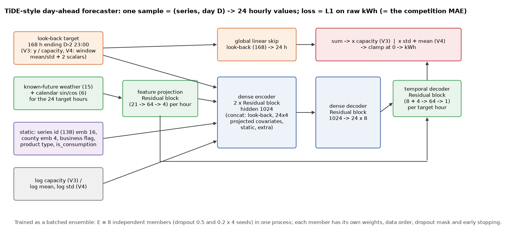</p>
<p align="center"><sub>The network of V3 and V4. Source: <code>src/enefit13/nn_ens.py</code>.</sub></p>

#### During training

<table>
<tr><td colspan="2">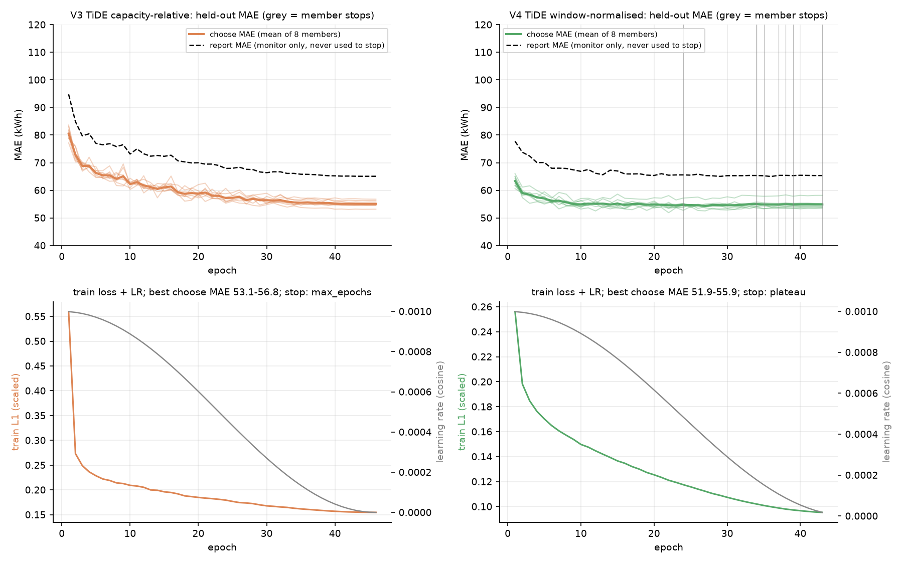<br><sub>Held-out MAE per epoch for the eight members of each network (thin lines), their mean, the monitor-only report MAE, and the train loss with the cosine schedule. V4 members stop on plateau between epochs 24 and 43; V3 reaches its epoch cap while still improving. Source: <code>results/dl/run2_amp/*/*_history.json</code>.</sub></td></tr>
<tr>
<td width="50%">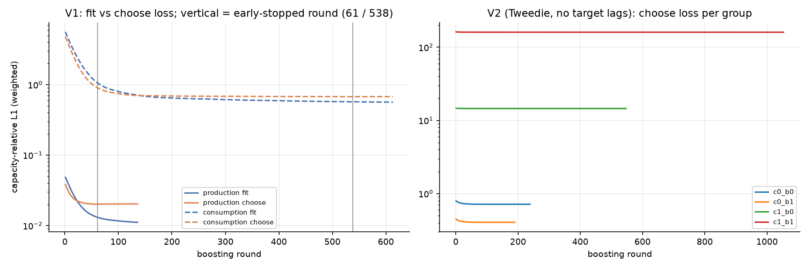<br><sub>LightGBM fit and choose loss per round. The production booster stops at round 61 because the choose month has little sun. Source: <code>results/backtest/*/*_history.json</code>.</sub></td>
<td width="50%">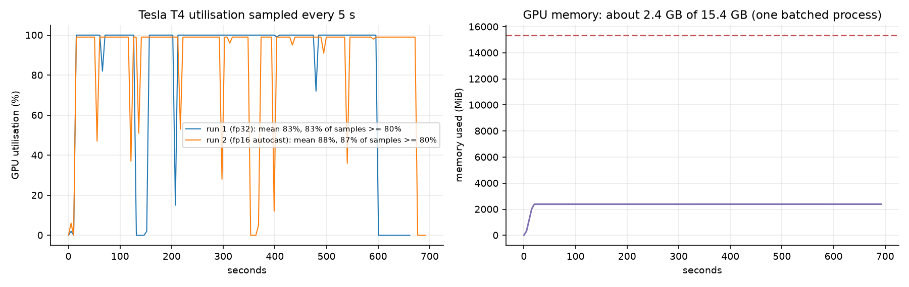<br><sub>T4 utilisation (mean 83 % fp32, 88 % fp16) and memory (about 2.4 of 15.4 GB). Source: <code>results/dl/*/gpu_utilisation.json</code>.</sub></td>
</tr>
</table>

#### After training

<table>
<tr>
<td width="50%">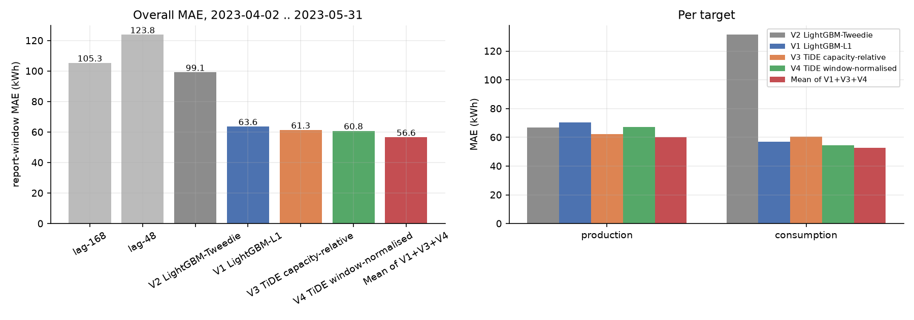<br><sub>Every model against the baselines, overall and per target. Source: <code>results/post/by_target.csv</code>.</sub></td>
<td width="50%">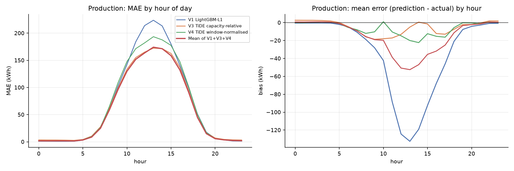<br><sub>Production error and bias by hour. At 13:00 V1 under-predicts by 133 kWh on average, V3 by 5 and V4 by 20. Source: <code>results/post/by_hour.csv</code>.</sub></td>
</tr>
<tr>
<td width="50%">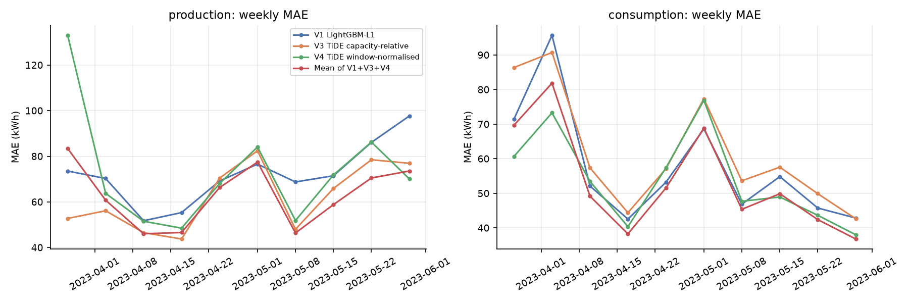<br><sub>Weekly MAE through the report window. Source: <code>results/post/by_week.csv</code>.</sub></td>
<td width="50%">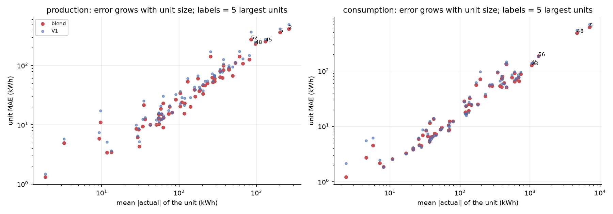<br><sub>Unit MAE against unit size: error grows with size and the largest segments set the metric. Source: <code>results/post/by_unit.csv</code>.</sub></td>
</tr>
<tr>
<td width="50%">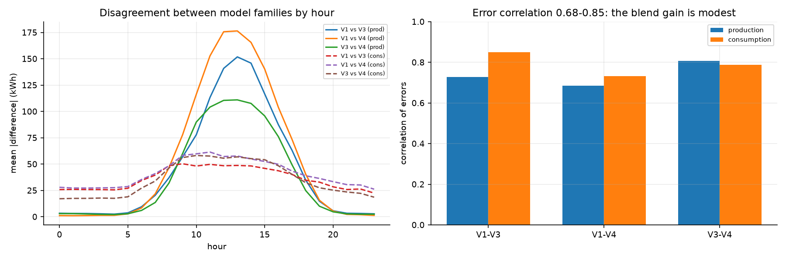<br><sub>Disagreement between the model families and the correlation of their errors (0.68 to 0.85). Sources: <code>results/post/disagreement_by_hour.csv</code>, <code>error_correlation.csv</code>.</sub></td>
<td width="50%"></td>
</tr>
</table>

### Reproducing

See [`enefit-prosumer-energy/README.md`](enefit-prosumer-energy/README.md) for every command. In short:

```bash
cd enefit-prosumer-energy
pip install -r requirements.txt
python -m pytest tests -q                          # leakage mutants, input-influence probe
python scripts/data_profile.py                     # data profile and baselines
python src/run_variant.py --variant v1 --root data --out results/backtest
python src/prep_dl.py --root data --out prep && python src/run_dl_ens.py --prep prep --out results/dl --variants v3,v4
python scripts/make_figures.py
```

Requirements: Python 3.12, LightGBM 4, PyTorch 2 with CUDA (a 16 GB T4 is enough; the ensembles use 2.4 GB). The
competition data is not redistributed here.

### Limitations

- A single 60-day origin, no confidence intervals: differences below about 1 kWh between V3 and V4 are not a ranking.
- Not scored on Kaggle (see the disclaimer), so there is no leaderboard comparison.
- V3 was still improving at its epoch cap; the same-season tuning of the LightGBM models was implemented but not run.

### References

1. I. Nasios, K. Vogklis. *Blending gradient boosted trees and neural networks for point and probabilistic forecasting of hierarchical time series.* arXiv:2310.13029, 2023.
2. A. Das, W. Kong, A. Leach, S. Mathur, R. Sen, R. Yu. *Long-term Forecasting with TiDE: Time-series Dense Encoder.* arXiv:2304.08424, 2023.
3. Y. Liu, H. Wu, J. Wang, M. Long. *Non-stationary Transformers: Exploring the Stationarity in Time Series Forecasting.* arXiv:2205.14415, 2022.
4. G. Ke, Q. Meng, T. Finley, T. Wang et al. *LightGBM: A Highly Efficient Gradient Boosting Decision Tree.* NeurIPS 2017.

Others that were studied are listed in [`enefit-prosumer-energy/REFERENCES.md`](enefit-prosumer-energy/REFERENCES.md).

## Optiver realized volatility: cross-stock features with a CNN, a set transformer and a blend

### The problem

For 112 stocks and about 3,830 ten-minute windows the data has the top two levels of the order book and the executed
trades at one-second resolution. The label is the realised volatility of the **next** ten minutes. The score is the root
mean square **percentage** error, so relative errors on small labels count as much as on large ones. Four facts shape
every model here:

- the plain realised volatility of the current window is already strong (correlation 0.911 with the log label, RMSPE
  0.2858 after one fitted constant);
- the book is sparse (median 388 of 600 seconds), which is why noise-robust estimators were expected to help;
- a window's cross-stock mean explains 55.6 % of the log-label variance: all stocks share a market factor;
- window ids are shuffled, so there is no temporal order to use or to validate on.

### Disclaimer on compute and on the result

> Everything ran on **low-tier hardware**: features, ridge and LightGBM on an **8-core CPU sandbox** in 205 s, and the
> neural networks on **one NVIDIA L4** (12 vCPUs) in 439 s for the build plus six training processes. The networks have
> 265 k (CNN) and 417 k (set transformer) parameters.
>
> The numbers below are **local report-role results** on a random split of the shuffled windows. The late Kaggle
> submission shows a **public score of 0.0, which is not credible** (see below), and a **private score of 0.24597**,
> worse than the local 0.2057.

### Results

| Model | What it is | Report RMSPE |
| --- | --- | --- |
| plain volatility, one constant | baseline (all labelled rows) | 0.2858 |
| V1 | ridge on log target, plain volatility features | 0.2432 |
| V1 + estimators | the same plus pre-averaging estimators | 0.2431 |
| V2 per-stock | LightGBM, per-stock features | 0.2384 |
| V2 cross-stock | LightGBM plus same-window cross-stock aggregates | 0.2219 |
| V3 | 1-D CNN on the 120 x 13 tensor + features, 3 seeds | 0.2073 |
| V4 | transformer over the stocks of one window, 3 seeds | 0.2074 |
| blend | V2 0.1 + V3 0.4 + V4 0.5 (weights chosen on the *choose* role) | **0.2057** |

Fit 70 % / choose 15 % / report 15 % of the `time_id`s, report role of 62,491 windows. Sources:
[`results/metrics.csv`](optiver-realized-volatility/results/metrics.csv), [`results/cpu/`](optiver-realized-volatility/results/cpu/),
[`results/gpu/`](optiver-realized-volatility/results/gpu/).

### The scorer's 0.0

The competition has closed and the blend was submitted late as a code-competition notebook. The notebook first reproduced
the local numbers on the mounted training files (report 0.2057), so the weights and features arrived intact. The scorer
then displays:

| Column | Value |
| --- | --- |
| Public score | **0.00000** ("perfect score"; would beat the best benchmark of 0.19548 quoted by the repository owner) |
| Private score | 0.24597 |
| Local report RMSPE | 0.2057 |

An RMSPE of exactly zero would mean every prediction equals its target, which a volatility forecast cannot do, and the same
listing shows 0.24597 for the same file. The 0.0 is treated here as a scorer artefact of unknown cause (the public test
file is a three-row stub), not as a result. The private score is the one that measures the forecasting period, and it does
not beat the benchmark. Details and untested explanations of the gap:
[`optiver-realized-volatility/README.md`](optiver-realized-volatility/README.md#kaggle-scoring).

### Experiment notes

- The noise-robust (pre-averaging) estimators added nothing over plain realised volatility (0.2431 against 0.2432): the
  windows hold a few hundred observations, far from the sample sizes the estimator theory is built for.
- The same-window cross-stock aggregates were the clear gain in LightGBM (0.2384 to 0.2219).
- The first estimator implementation had a wrong constant; a simulation with known noise exposed it and a test now guards it.
  The dependent-noise second step was too unstable on windows this short and the i.i.d. second step is used.

Full table, defects and the feature list: [`optiver-realized-volatility/README.md`](optiver-realized-volatility/README.md#experiment-notes).

### Methodologies

The four model families, the roles and the loss are described in
[`optiver-realized-volatility/README.md`](optiver-realized-volatility/README.md#the-four-methodologies).

### Visualizations

Every figure is regenerated by `python scripts/make_figures.py` from the files in
[`optiver-realized-volatility/results/`](optiver-realized-volatility/results/).

#### During training

<table>
<tr><td colspan="2">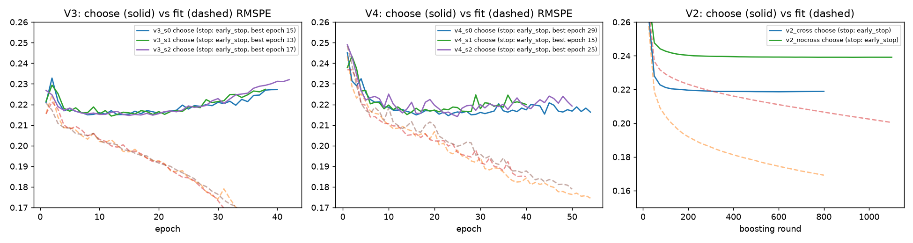<br><sub>Choose (solid) and fit (dashed) RMSPE per epoch for the three seeds of each network and per round for LightGBM. The networks reach their best choose error at epoch 13 to 29 while the fit error keeps falling; both LightGBM models stop early on a flat choose curve. Source: <code>results/gpu/*_history.json</code>, <code>results/cpu/v2_*_history.json</code>.</sub></td></tr>
</table>

#### After training

<table>
<tr>
<td width="50%">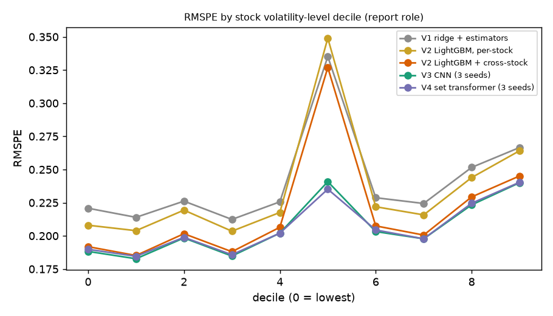<br><sub>Report RMSPE by stock volatility-level decile. The neural models cut the error of one mid-level decile (decile 5) from about 0.33 to 0.24; the reason was not investigated. Source: <code>results/post/by_stock_level.csv</code>.</sub></td>
<td width="50%">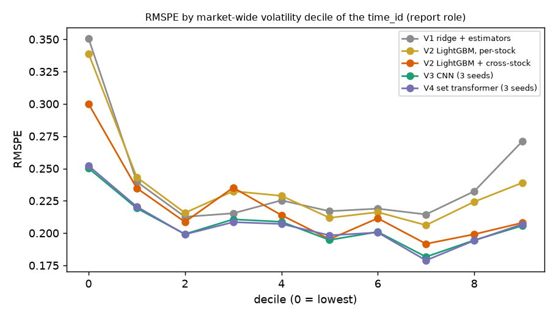<br><sub>Report RMSPE by market-wide volatility decile of the window. Calm windows (decile 0) have the highest error and the largest gain from the neural models and the cross-stock features. Source: <code>results/post/by_regime.csv</code>.</sub></td>
</tr>
<tr>
<td width="50%">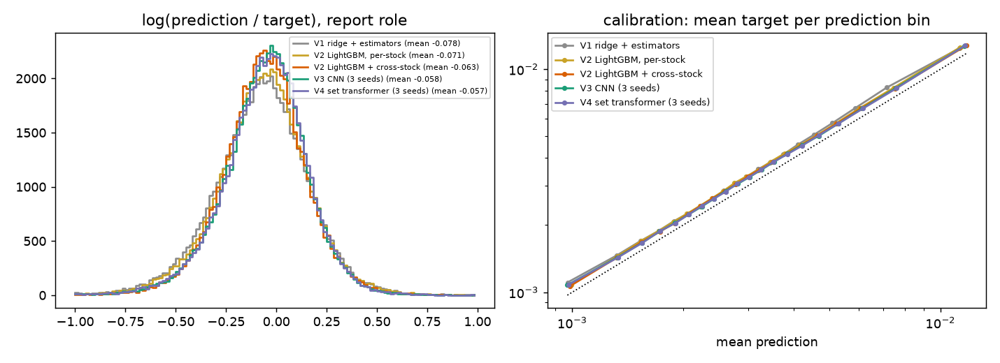<br><sub>Log ratio of prediction to target and binned calibration. All models sit below the target on average (-0.06 to -0.08), which is the RMSPE-optimal shading. Sources: <code>results/post/residual_hist.csv</code>, <code>calibration.csv</code>.</sub></td>
<td width="50%">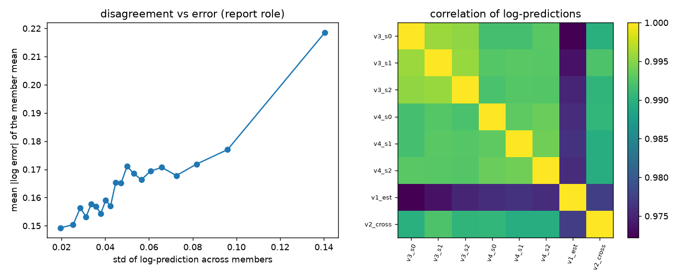<br><sub>Error rises with the disagreement between members (0.15 to 0.22 in mean absolute log error); member predictions correlate 0.97 to 0.995 in logs. Sources: <code>results/post/disagreement.csv</code>, <code>member_correlation.csv</code>.</sub></td>
</tr>
<tr>
<td width="50%">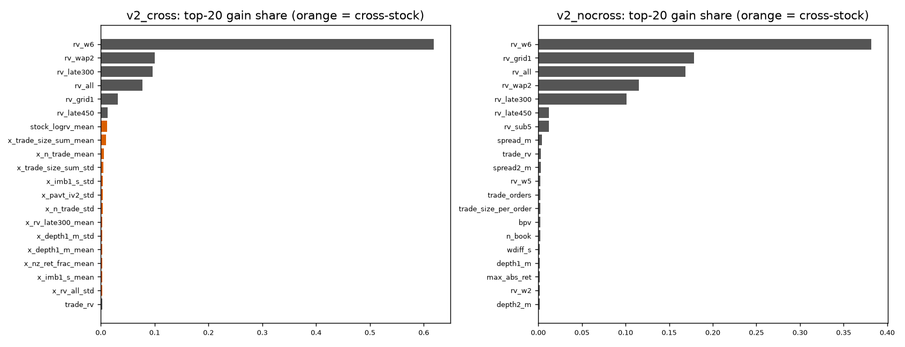<br><sub>LightGBM gain importance with and without the cross-stock features. Realised volatility over the whole window dominates; individual cross-stock features carry at most about 1 % of the gain each although together they lower the error by about 7 %. Source: <code>results/cpu/v2_*_importance.csv</code>.</sub></td>
<td width="50%"></td>
</tr>
</table>

### Reproducing

See [`optiver-realized-volatility/README.md`](optiver-realized-volatility/README.md#reproducing) for every command. In short:

```bash
cd optiver-realized-volatility
pip install -r requirements.txt
python -m pytest tests -q
export OPT_DATA_DIR=/path/to/optiver-realized-volatility-prediction
python src/run_cpu.py --out runs/cpu --workers 7
python src/run_gpu.py --out runs/gpu
python scripts/aggregate_predictions.py --results runs --out results && python scripts/make_figures.py
```

Requirements: Python 3.12, LightGBM 4, PyTorch 2 with CUDA (a 16 GB card is enough; the six processes use 9.5 GB). The
competition data is not redistributed here.

### Limitations

- One random split of shuffled windows, no confidence intervals; V3 and V4 are not separable.
- The local score does not measure the shift to the forecasting period, and the private score shows that shift is large.
- The cross-stock models assume most stocks of a window are present when predicting.
- The public 0.0 is unexplained; it is reported, not interpreted as performance.

### References

1. Q. Chen, C.-Y. Robert. *Multivariate Realized Volatility Forecasting with Graph Neural Network.* arXiv:2112.09015, 2021.
2. A. Lensky, M. Hao. *Learning to Predict Short-Term Volatility with Order Flow Image Representation.* arXiv:2304.02472, 2023.
3. Z. M. Li, R. J. A. Laeven, M. H. Vellekoop. *Dependent Microstructure Noise and Integrated Volatility Estimation from High-Frequency Data.* arXiv:1704.08964.
4. J. Lee, Y. Lee, J. Kim, A. Kosiorek, S. Choi, Y. W. Teh. *Set Transformer.* ICML 2019, arXiv:1810.00825.
5. G. Ke et al. *LightGBM: A Highly Efficient Gradient Boosting Decision Tree.* NeurIPS 2017.

Others that were read are listed in [`optiver-realized-volatility/REFERENCES.md`](optiver-realized-volatility/REFERENCES.md).

## M5 forecasting accuracy: per-store gradient boosting, with and without lag features

### The problem

The data has 1,941 days of unit sales for 30,490 item-store series (3,049 items in 10 stores of three states), the calendar
with events and SNAP days, and weekly sell prices. The task is to forecast the next 28 days. The score is the weighted root
mean squared scaled error (WRMSSE) over 12 aggregation levels, 42,840 series from the grand total down to item by store.
Five facts shape every model here:

- 68.0 % of the cells are zero and 76 % of the series are intermittent;
- 77.1 % of the series have their first sale after the first day, so many series are young;
- a strong weekday profile and a SNAP effect on food sales (ratio 1.10 to 1.30 by state);
- the upper levels carry most of the weight, and they are scored on the scale of their own history;
- the mean of the last 28 days times a 52-week weekday profile already scores WRMSSE 0.7161 on the report window.

### Disclaimer on compute and on the result

> The four variants ran on a **4-core, 16 GiB cloud CPU sandbox** in 98 s, with no GPU. The result is a **single-origin
> forecast per role** (28 days each) without confidence intervals.
>
> Only V4 beats the weekday-profile baseline. V1 to V3 are worse than it on both windows, and the reconciliation and
> alignment steps both came out as no-ops (the strength chosen on the choose window was 0).

### Leaderboard

<p align="center">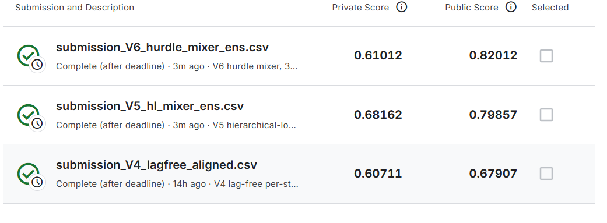</p>

| Submission | What it is | Choose | Report | Public | Private |
| --- | --- | --- | --- | --- | --- |
| `submission_V4_lagfree_aligned` | lag-free per-store LightGBM (alignment strength chosen 0) | 0.5856 | 0.6791 | **0.67907** | **0.60711** |

The CSV was submitted after the deadline. The public window is the report window, and the public score equals the local
report score to four digits, so the local scorer reproduces the competition's. Source:
[`results/kaggle_scores.csv`](m5-forecasting-accuracy/results/kaggle_scores.csv).

### Results

| Model | What it is | Choose WRMSSE | Report WRMSSE |
| --- | --- | --- | --- |
| baseline | mean of last 28 days x weekday profile (52 weeks) | 0.6430 | 0.7161 |
| V1 | per-store LightGBM, direct over the horizon, squared loss | 0.6689 | 0.7772 |
| V2 | the same with the Tweedie loss | 0.6617 | 0.7938 |
| V3 | V2 reconciled to a scaled aggregate-level model (strength chosen 0, so equal to V2) | 0.6617 | 0.7938 |
| V4 | lag-free per-store LightGBM on calendar, price and item codes (alignment strength chosen 0) | **0.5856** | **0.6791** |

Fit on targets up to d_1885; *choose* = d_1886 to d_1913, *report* = d_1914 to d_1941, both forecast from the fitted models
without refitting. Sources: [`results/metrics.csv`](m5-forecasting-accuracy/results/metrics.csv),
[`results/per_level.csv`](m5-forecasting-accuracy/results/per_level.csv).

### Experiment notes

- Dropping every lag feature (V4) improved the aggregate levels (total 0.50 against 0.72 for V1) and worsened the three item levels (0.97, 0.92, 0.88 against 0.87, 0.85, 0.84).
- Every model forecasts too little in total over the report window (0.92 to 0.96 of the actual sum) and every model has its largest daily error on forecast day 21.
- A first run with learning rate 0.1 gave V4 report 0.6664; the second run (rate 0.05, longer patience) 0.6791. The settings were changed after seeing the first run, so they are not a tuning gain, and the second run is the one reported.

Full notes: [`m5-forecasting-accuracy/README.md`](m5-forecasting-accuracy/README.md#experiment-notes).

### Methodologies

The four variants, the fixed roles and the score are described in
[`m5-forecasting-accuracy/README.md`](m5-forecasting-accuracy/README.md#the-four-variants).

### Visualizations

Every figure is regenerated by `python scripts/make_figures.py` from the files in
[`m5-forecasting-accuracy/results/`](m5-forecasting-accuracy/results/).

#### After training

<table>
<tr>
<td width="50%">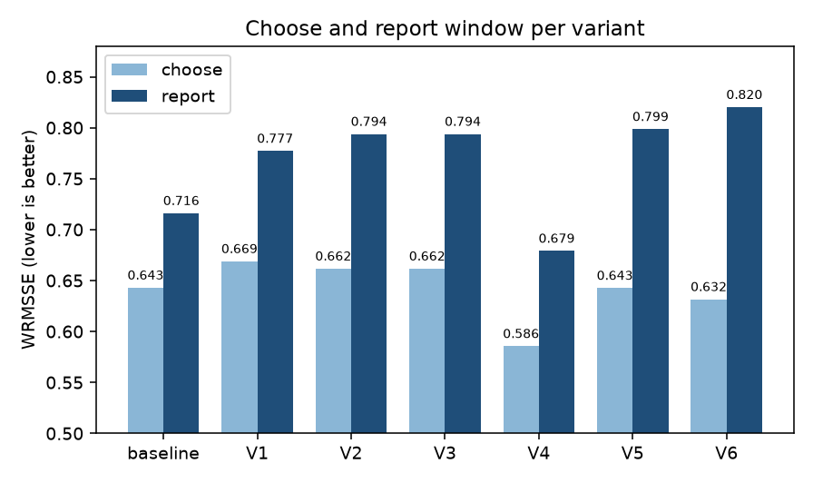<br><sub>WRMSSE of the baseline and the four variants on the choose and report windows. Only V4 is below the baseline on both. Source: <code>results/metrics.csv</code>.</sub></td>
<td width="50%">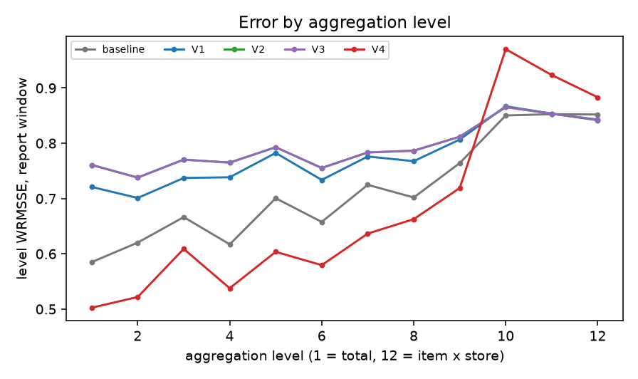<br><sub>Report error by aggregation level. V4 is best at the upper levels and worst at the three item levels. Source: <code>results/per_level.csv</code>.</sub></td>
</tr>
<tr>
<td width="50%">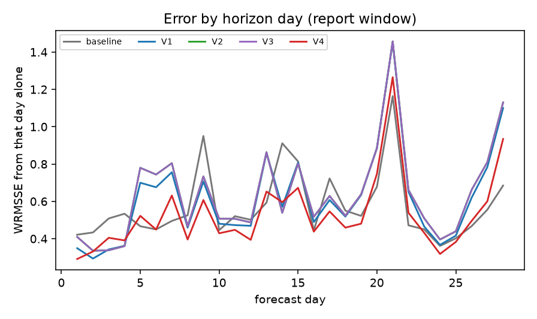<br><sub>WRMSSE computed from one forecast day at a time. All models, the baseline included, peak on day 21. Source: <code>results/per_horizon.csv</code>.</sub></td>
<td width="50%">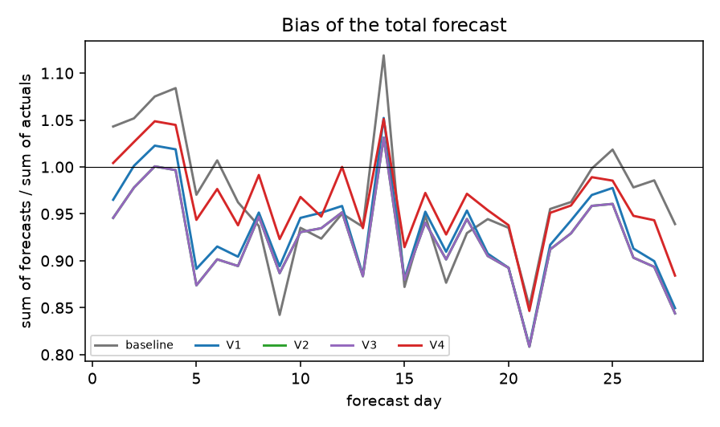<br><sub>Sum of forecasts over sum of actuals per forecast day; the models fall below 1 on most days. Source: <code>results/bias_total.csv</code>.</sub></td>
</tr>
<tr>
<td width="50%">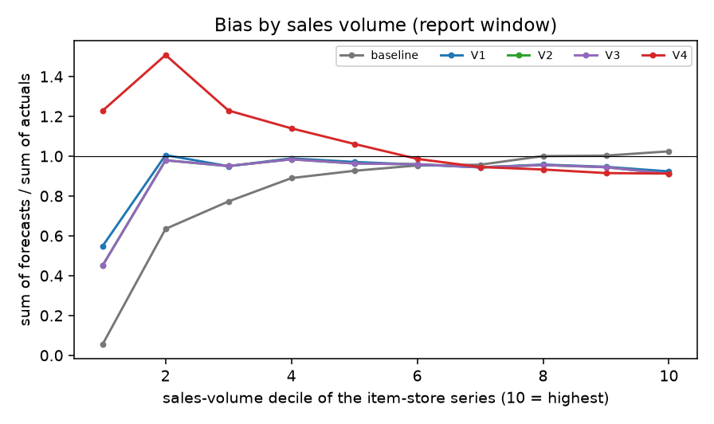<br><sub>The same ratio by sales-volume decile of the item-store series: V2 forecasts 0.45 of the actual in the lowest decile, V4 forecasts 1.2 to 1.5 times the actual in the three lowest. Source: <code>results/bias_by_volume.csv</code>.</sub></td>
<td width="50%">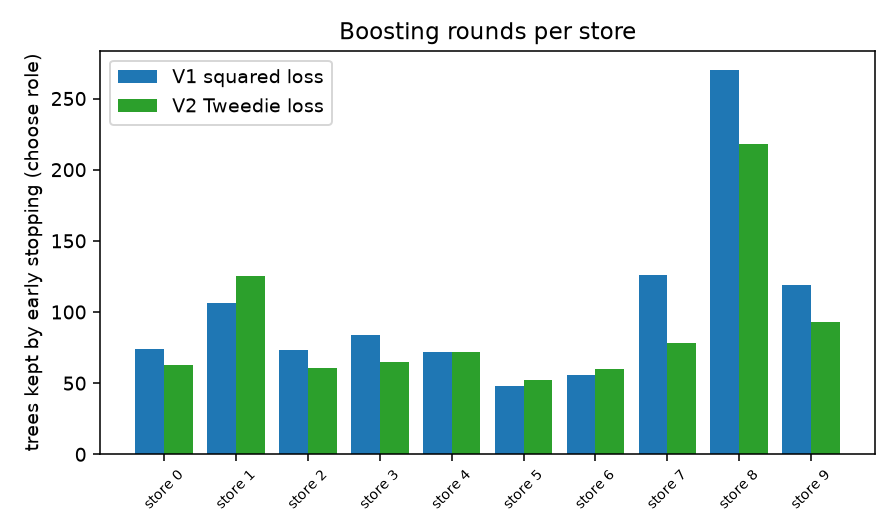<br><sub>Trees kept by early stopping on the choose window, per store: 48 to 270 for V1 and 52 to 218 for V2. Source: <code>results/store_iterations.csv</code>.</sub></td>
</tr>
</table>

### Reproducing

See [`m5-forecasting-accuracy/README.md`](m5-forecasting-accuracy/README.md#reproducing) for every command. In short:

```bash
cd m5-forecasting-accuracy
pip install -r requirements.txt
export M5_DATA_DIR=/path/to/m5-forecasting-accuracy
python scripts/build_prep.py && python -m pytest tests -q
python src/cpu_variants.py --cores 4 | tee results/cpu_run.log
python scripts/analyze.py && python scripts/make_figures.py
```

Requirements: Python 3.11 or newer, LightGBM 4, a multi-core CPU with 16 GiB of memory. The competition data is not
redistributed here.

### Limitations

- One 28-day window per role and no confidence intervals; the order of V1, V2 and V3 is not reliable.
- The models are not refitted for the later forecast origins.
- Reconciliation and alignment were tested on a three-value grid on one window and both came out as no-ops.
- V4 has no recent-demand information besides the item code.
- Two neural variants trained on a GPU are not part of this folder.

### References

1. S. Makridakis, E. Spiliotis, V. Assimakopoulos et al. *The M5 accuracy competition: Results, findings, and conclusions.* International Journal of Forecasting 38(4), 2022.
2. M. Anderer, F. Li. *Hierarchical forecasting with a top-down alignment of independent level forecasts.* arXiv:2103.08250, 2021.
3. Z. Islam, A. Mohammed. *Global tree forecasters collapse at the hierarchical aggregate: a five-panel failure characterization.* arXiv:2609.27912.
4. G. Ke et al. *LightGBM: A Highly Efficient Gradient Boosting Decision Tree.* NeurIPS 2017.

Others that were read are listed in [`m5-forecasting-accuracy/REFERENCES.md`](m5-forecasting-accuracy/REFERENCES.md).

### License

Code: MIT ([LICENSE](LICENSE)). The competition data belongs to its owners and is not included.
