# kaggle-timeseries

Sequence and time-series projects from Kaggle competitions. Each project has its own folder with its code, tests, logs and
figures, and its own detailed README.

| Folder | Competition | Task | Best result (RMSE, ft) |
| --- | --- | --- | --- |
| [`rogii-wellbore-geology/`](rogii-wellbore-geology/) | [ROGII Wellbore Geology Prediction](https://www.kaggle.com/competitions/rogii-wellbore-geology-prediction) (2026) | Predict the stratigraphic depth (TVT) of a horizontal well beyond the last interpreted point, from gamma ray, trajectory and a vertical type well | **11.622 public / 11.980 private** |

---

## ROGII wellbore geology: 2-D candidate-grid U-Nets with a row-level stack

### The problem

A horizontal well is drilled through layered rock. Along the well we know the measured depth (MD), the position
(X, Y, Z) and a gamma-ray log (GR). Each well comes with a nearby vertical **type well**, which gives GR as a function of
true vertical thickness (TVT), a depth coordinate that follows the layers. Interpreters have labelled TVT up to some
point of each horizontal well. The task is to predict TVT for every row after that point, which we call the **cut**.
The score is the root mean squared error pooled over all predicted rows, in feet.

Doing nothing already sets a strong baseline: the **carry-forward** prediction (repeat the last known TVT) scores
15.71 ft on our report folds. Every model below is judged by how far it gets below that baseline.

### Disclaimer on compute

> Everything ran on **low-tier hardware: one GPU at a time**.
>
> - Round 1 sequence models (GRU-D, SSM): one **NVIDIA T4**.
> - Final U-Nets: one **NVIDIA L4**, a T4-class card.
> - Trackers and gradient boosting: a multi-core CPU.
>
> The submitted pipeline used about **1.7 GPU-hours** of training: 15 cross-validation runs plus 3 full-data runs of
> 12 epochs each, logged in [`results/training/`](rogii-wellbore-geology/results/training/). The final U-Nets have
> 0.5 M to 2.1 M parameters. Top leaderboard solutions use far more compute, more seeds, longer schedules and
> synthetic-well pre-training. For this budget, a private score of 11.98 ft is a decent result, not a state-of-the-art
> one. Out-of-fold, the submitted model is 17 % below carry-forward.

### Leaderboard

<p align="center"></p>

| Submission | What it is | Out-of-fold, folds 2-5 | Out-of-fold, all folds | Public | Private |
| --- | --- | --- | --- | --- | --- |
| `rogii-grid-unet-b` | 3-width U-Net snapshot blend + gradient-boosted margin | 13.070 | 13.296 | **11.622** | **11.980** |
| `rogii-grid-unet-a` | 3-width U-Net snapshot blend | 13.270 | 13.453 | 12.008 | 12.180 |

These are code-competition submissions: a Kaggle notebook ([`notebooks/inference.ipynb`](rogii-wellbore-geology/notebooks/inference.ipynb))
loads frozen checkpoints and predicts the hidden test wells. Both were scored after the competition deadline. Sources:
[`results/leaderboard.csv`](rogii-wellbore-geology/results/leaderboard.csv) and
[`results/stack/stack_log.jsonl`](rogii-wellbore-geology/results/stack/stack_log.jsonl).

### Experiment history: what failed before the submission

Most attempts failed. A model counts as useful only if it beats **carry-forward** on the same rows, because simply
repeating the last known TVT is a strong baseline (15.71 ft on folds 2-5, 16.75 ft on fold 1). Each experiment below
was scored on held-out wells under fixed fold roles: fold 1 for choices, folds 2-5 for reporting. The table includes
every attempt, including the abandoned ones.

<p align="center">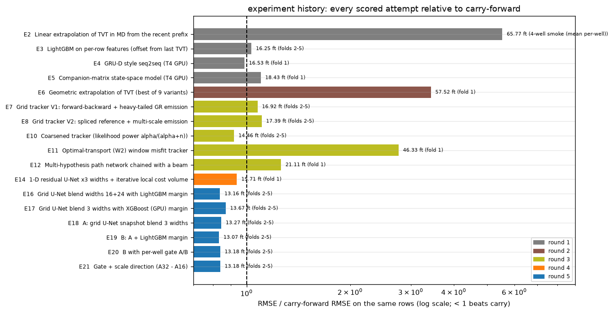</p>
<p align="center"><sub>Every scored experiment as a ratio to carry-forward on the same rows (below 1 is better). Source: <code>results/history/experiments.csv</code>.</sub></p>

| # | Round | Experiment | Scored on | RMSE (ft) | Carry (ft) | Outcome |
| --- | --- | --- | --- | --- | --- | --- |
| E1 | 1 | Carry-forward | folds 2-5 | 15.71 | 15.71 | reference |
| E2 | 1 | Linear extrapolation of TVT in MD | 4-well smoke test | 65.77 | 11.88 | failed: drifts off quickly |
| E3 | 1 | LightGBM on per-row features | folds 2-5 | 16.24 | 15.71 | **worse than carry** |
| E4 | 1 | GRU-D-style seq2seq (T4) | fold 1 | 16.53 | 16.75 | barely better |
| E5 | 1 | Companion-matrix state-space model (T4) | fold 1 | 18.43 | 16.75 | **worse than carry** |
| E6 | 2 | Geometric extrapolation of TVT (best of 9 variants) | fold 1 | 57.52 | 16.75 | failed |
| E7 | 3 | Grid tracker V1 (exact Bayesian) | folds 2-5 | 16.92 | 15.71 | **worse than carry**: locks onto wrong layers |
| E8 | 3 | Grid tracker V2 (multi-scale emission) | folds 2-5 | 17.38 | 15.71 | **worse than carry** |
| E9 | 3 | Tracker with learned (LightGBM) emission | fold 1 smoke | AUC 0.896 | - | abandoned before tracking |
| E10 | 3 | Coarsened tracker | folds 2-5 | 14.46 | 15.71 | first win over carry |
| E11 | 3 | Optimal-transport (W2) window tracker | fold 1 | 46.33 | 16.75 | failed |
| E12 | 3 | Multi-hypothesis net chained with a beam | fold 1 | 21.11 | 16.75 | failed |
| E13 | 3 | Fusion of E10-E12 | - | - | - | not run (two of three parts failed) |
| E14 | 4 | 1-D residual U-Nets with iterative cost volume | fold 1 | 15.71 | 16.75 | small gain |
| E15 | 4 | Block-level LightGBM base | folds 1-5 | block metric only | - | superseded |
| E16 | 5 | Grid U-Net, widths 16+24, plus LightGBM margin | folds 2-5 | 13.16 | 15.71 | superseded by three widths |
| E17 | 5 | Grid U-Net, 3 widths, plus XGBoost (GPU) margin | folds 2-5 | 13.67 | 15.71 | margin overfit |
| **E18** | 5 | **A: grid U-Net snapshot blend, 3 widths** | folds 2-5 | **13.27** | 15.71 | **submitted: 12.180 private** |
| **E19** | 5 | **B: A + LightGBM margin** | folds 2-5 | **13.07** | 15.71 | **submitted: 11.980 private (best)** |
| E20 | 5 | B with a per-well A/B gate | folds 2-5 | 13.18 | 15.71 | not better than B |
| E21 | 5 | Gate + scale direction | folds 2-5 | 13.18 | 15.71 | not better than B |

Sources: [`results/history/`](rogii-wellbore-geology/results/history/), [`results/baselines/`](rogii-wellbore-geology/results/baselines/)
and [`results/stack/`](rogii-wellbore-geology/results/stack/). E2 is a mean of per-well RMSEs; every other number is a
pooled row RMSE. Fold 1 numbers come from the fold used for choices, so they are slightly optimistic.

**What each round taught the next one.**

1. **Generic forecasters fail** (E2-E5). Predicting TVT from the well's own recent history ignores the only real
   evidence, the match between the well's GR and the type well. Errors grow with distance from the cut, and the
   models end up close to carry-forward.
2. **Pure geometry fails** (E6). Extrapolating TVT linearly in X, Y, Z or MD amplifies small slope errors over
   thousands of rows.
3. **Exact Bayesian tracking is overconfident** (E7-E8). Thousands of correlated GR samples are treated as independent
   evidence. The posterior collapses onto one layer, which is often wrong where layers repeat. Coarsening the
   likelihood (E10) fixed the overconfidence and gave the first gain. More expressive likelihoods (E11 optimal
   transport, E12 multi-hypothesis net) were worse.
4. **Learned 1-D models help a little** (E14). A 1-D U-Net with a local cost volume only sees a narrow window of
   candidate depths around its current estimate. When the estimate drifts, the right layer leaves the window.
5. **The 2-D image formulation works** (E16-E21). The model sees every candidate depth (±96 ft) at once for the whole
   suffix, alongside the known history and a constant-dip prior. It then decodes an expected value, which is what
   RMSE rewards. A gradient-boosted margin trained on out-of-fold errors adds a little. Extra stack levels (gate,
   scale direction) did not generalise.

### Methodologies

Every method (E1-E21), with input, model, output and outcome: [`rogii-wellbore-geology/docs/methodologies.md`](rogii-wellbore-geology/docs/methodologies.md).

### Key mathematical points

**1. The target is a slowly varying surface minus depth.** Inside one well,

$$\mathrm{TVT}(s) = u(s) - Z(s),$$

where $u$ is the elevation of a stratigraphic reference surface along the well path $s$ (MD). The vertical position
$Z$ is known for every row, so all the difficulty lies in $u$, which changes slowly with the dip of the layers. Two
priors follow from this:

- **Constant dip.** Extrapolate $u$ linearly in MD from the last 300 known rows:
  $\hat u(s) = u(s_p) + \beta\,(s - s_p)$. The prior offset is then $\hat u(s) - Z(s) - \mathrm{TVT}(s_p)$.
- **Smooth dip changes.** Write $d_k$ for the offset from the last known TVT in block $k$, and $v_k$ for its change
  per block. Then

$$v_k = \alpha\,v_{k-1} + \varepsilon_k,\qquad d_k = d_{k-1} + v_k,\qquad \varepsilon_k \sim \mathcal N(0,\sigma^2).$$

  Fitted by least squares on the training wells, $\alpha \approx 0.90$ and $\sigma \approx 0.43$ grid cells
  (0.25 ft) per 10-row block. The mean-reversion term $\gamma\,d_{k-1}$ came out at about 0
  ([`results/baselines/tracker_v1_report.jsonl`](rogii-wellbore-geology/results/baselines/tracker_v1_report.jsonl)).

**2. Matching GR is the evidence.** We fit a linear calibration $\mathrm{GR}_h \approx a + b\,\mathrm{GR}_{tw}(\mathrm{TVT})$
on the known part of the well, with Huber reweighting. A candidate offset $d$ then predicts the reference value
$r(d) = a + b\,\mathrm{GR}_{tw}(\mathrm{TVT}_p + d)$. The heavy-tailed match score from rail-vehicle magnetic
localisation (Dieckow et al., 2025, Eq. 4) is

$$\log e(d) = -\log\!\left(1 + \frac{|\mathrm{GR}_h - r(d)|}{s}\right),$$

which keeps an outlier GR value from vetoing the correct depth.

**3. Baseline: an exact Bayesian tracker.** On a grid over $(d, v)$, the forward-backward algorithm gives the
posterior $p(d_k \mid \mathrm{GR})$. Its mean is the estimate that minimises the expected squared error. Exact
inference over-trusts thousands of correlated GR samples and locks onto wrong layers: it scored 16.92 ft, worse than
carry-forward. **Coarsening** the likelihood (Miller and Dunson, 2015), $e^{\zeta}$ with $\zeta = \alpha/(\alpha+n)$,
brings it to 14.46 ft.

**4. The main model reframes tracking as segmenting a 2-D image.** For each well we build an image
$X \in \mathbb R^{21 \times 256 \times 656}$:

- rows: 256 candidate offsets $o_i \in [-96, 96]$ ft, 0.75 ft apart;
- columns: 16 history blocks and 640 future blocks of 16 rows each;
- channels: GR, type-well GR at the candidate depth, their difference, the heavy-tailed score, a smoothed long-window
  difference, the known-history line, the constant-dip prior line, masks, 8 geometry rows and 2 coordinate maps.

A U-Net outputs logits $\ell_{ij}$. The model decodes them with a softmax over the rows, using a learned temperature
$\tau$:

$$p_{ij} = \frac{e^{\ell_{ij}/\tau}}{\sum_{i'} e^{\ell_{i'j}/\tau}},\qquad \hat d_j = \sum_i p_{ij}\,o_i .$$

The expected value, rather than the argmax, is what a squared-error metric rewards. The loss is

$$\mathcal L = \underbrace{-\sum_i q_{ij}\log p_{ij}}_{\text{soft target } q \propto \mathcal N(o_i;\,d_j,\,1\text{ ft}^2)} + 0.1\,|\hat d_j - d_j| + 0.1\,|\Delta\hat d_j - \Delta d_j|,$$

with the known-history columns weighted 0.25. Row predictions are linear interpolations between block centres,
anchored at offset 0 on the last known row.

**5. Augmentation from the prior.** Half of the training cuts are drawn at random. Half of the suffixes are
synthetic: a path perturbed by a draw from the AR(1) prior of point 1, with GR re-rendered from the type well plus the
well's own circularly shifted residual, scaled by a random factor.

**6. Stacking (submission B).** First, $A$ averages the snapshots of the second half of training (epochs 7-12) over
widths 16, 24 and 32. That is 18 checkpoints in the final model. Then a LightGBM model with Huber loss ($\delta = 5$)
learns the margin $y - A$ from 20 target-free features in an absolute frame: geometry, the dip prior, $A$ and its
slope, and GR residuals at $A$ and $A \pm 2$ ft. To avoid an optimistic margin, it is trained on **out-of-fold** $A$,
so that it learns the blend's held-out errors: $B = A + f(x)$. Two further levels were also evaluated:

- a per-well hard gate between $A$ and $B$;
- a scale direction $c\,(A_{32} - A_{16})$ with $c = \langle r, \Delta\rangle / \langle \Delta, \Delta\rangle$
  fitted on the four training folds.

Neither beat $B$ on the report folds, so the submitted model is $B$.

### Visualizations

Every figure is regenerated by `python scripts/make_figures.py` from the logs and CSVs in
[`rogii-wellbore-geology/results/`](rogii-wellbore-geology/results/).

#### During training

<table>
<tr><td colspan="2">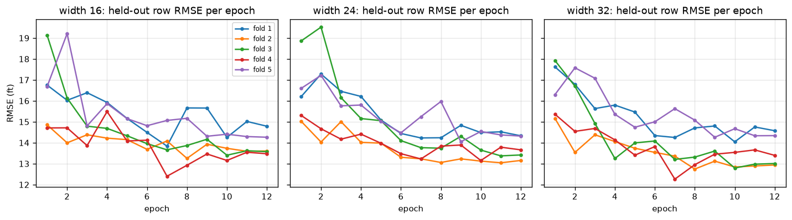<br><sub>Held-out row RMSE after every epoch, for each fold and width. Each fold's model is scored on wells it never saw. The curves flatten after about epoch 7, which is why snapshots from epochs 7-12 are averaged. Source: <code>results/training/train_fold*.jsonl</code>.</sub></td></tr>
<tr>
<td width="50%">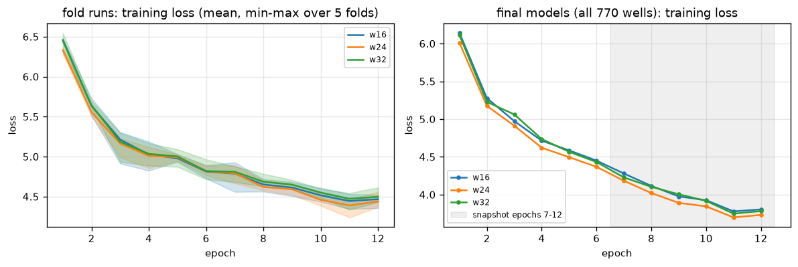<br><sub>Training loss: cross-validation runs (mean and min-max over folds) and the three full-data models; the snapshot epochs are shaded. Source: <code>results/training/*.jsonl</code>.</sub></td>
<td width="50%">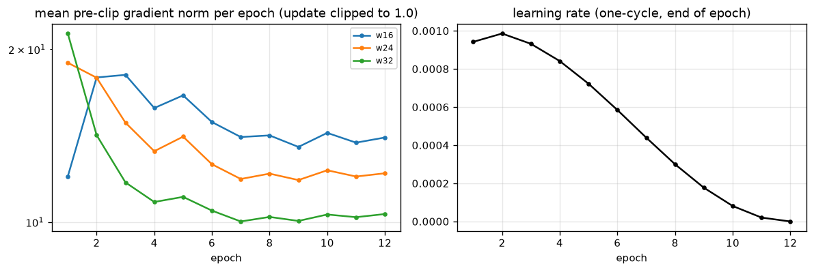<br><sub>Gradient norm before clipping, and the one-cycle learning rate. Wider nets settle at smaller gradient norms. Source: <code>results/training/train_fold*.jsonl</code>.</sub></td>
</tr>
<tr>
<td width="50%">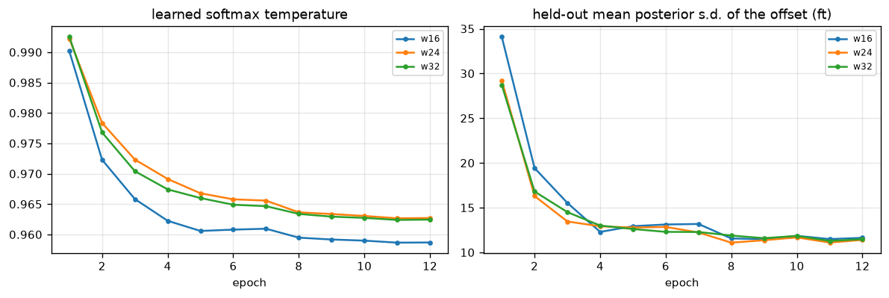<br><sub>Learned softmax temperature, and the mean standard deviation of the predicted offset on held-out wells, which tightens from 20-44 ft after epoch 1 to about 11-12 ft by epoch 12. Source: <code>results/training/train_fold*.jsonl</code>.</sub></td>
<td width="50%">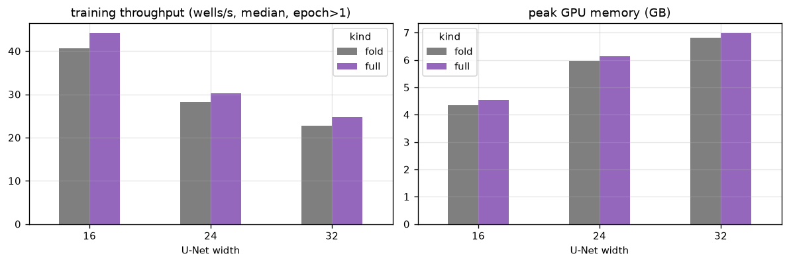<br><sub>Throughput and peak GPU memory per width on the single L4. Source: <code>results/training/*.jsonl</code>.</sub></td>
</tr>
</table>

#### After training

<table>
<tr>
<td width="50%">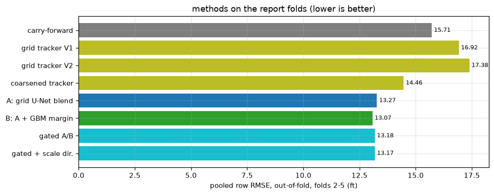<br><sub>Every method on the report folds (2-5, 616 wells, 3.0 M rows). Sources: <code>results/baselines/*.jsonl</code>, <code>results/stack/stack_log.jsonl</code>.</sub></td>
<td width="50%">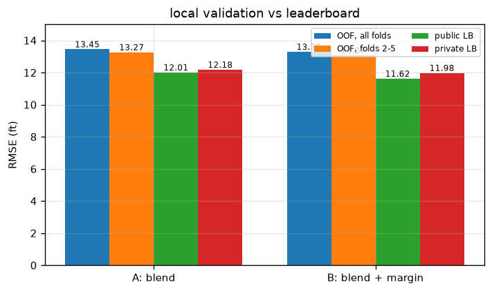<br><sub>Local out-of-fold RMSE against the public and private leaderboards. B beats A everywhere. Source: <code>results/leaderboard.csv</code>.</sub></td>
</tr>
<tr>
<td width="50%">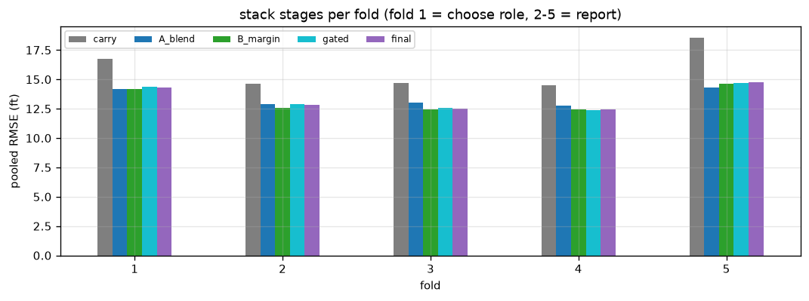<br><sub>Stack stages per fold. The margin helps on folds 2-4, ties on fold 1 and hurts on fold 5. Source: <code>results/stack/stack_log.jsonl</code>.</sub></td>
<td width="50%">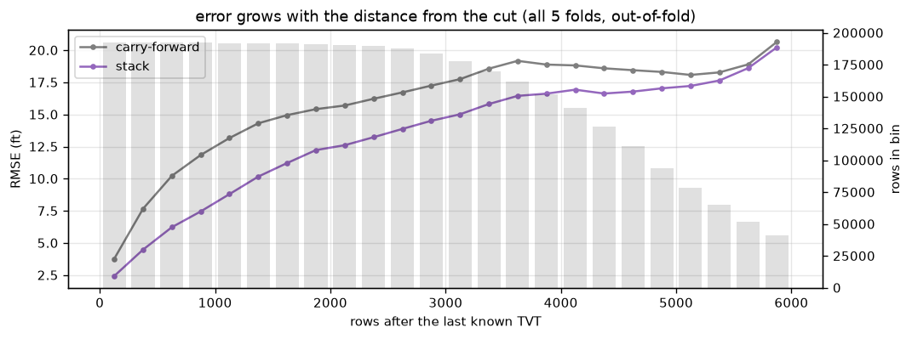<br><sub>Out-of-fold RMSE against distance from the cut. The gain over carry-forward peaks at about 4.4 ft between 500 and 1,500 rows after the cut and fades beyond 5,000 rows. Source: <code>results/stack/horizon_rmse.csv</code>.</sub></td>
</tr>
<tr>
<td width="50%">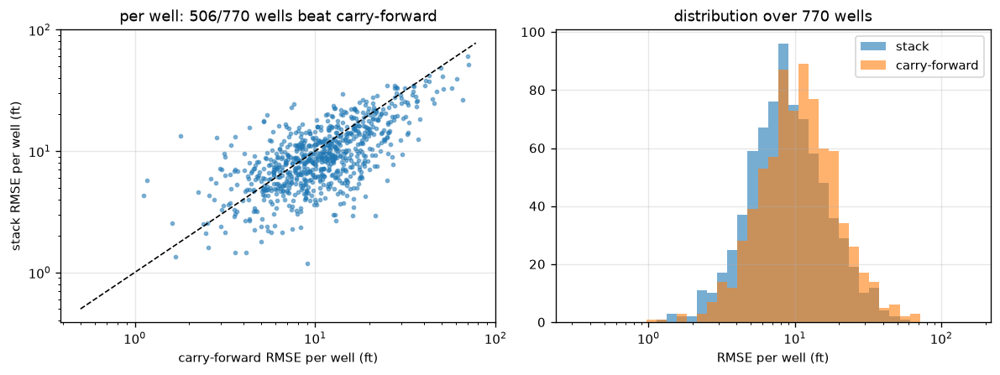<br><sub>Per-well RMSE of the stack against carry-forward: 506 of 770 wells improve. Source: <code>results/stack/final_per_well.csv</code>.</sub></td>
<td width="50%">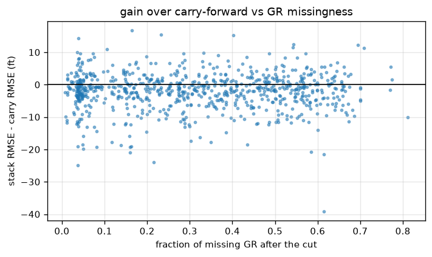<br><sub>Gain over carry-forward against the fraction of missing GR after the cut. Source: <code>results/stack/final_per_well.csv</code>.</sub></td>
</tr>
</table>

### Reproducing

See [`rogii-wellbore-geology/README.md`](rogii-wellbore-geology/README.md) for every command. In short:

```bash
cd rogii-wellbore-geology
pip install -r requirements.txt
bash scripts/fetch_data.sh                         # Kaggle CLI; competition rules must be accepted
python src/prepare_data.py --source data/extracted --out data/stage
python -m pytest tests -q                          # leakage mutants
python src/grid_unet.py --fold 1 --runs 16:0,24:0,32:0   # one CV fold (repeat for 2-5)
python src/grid_unet.py --fold 0 --runs 16:0,24:0,32:0   # final full-data checkpoints
python src/stack.py --grid runs/grid --out runs/stack     # out-of-fold stack and metrics
python src/final_margin.py --grid runs/grid --out runs/final
python scripts/make_figures.py                     # figures from results/
```

Requirements: Python 3.12, PyTorch 2.x with CUDA, a GPU with at least 8 GB (the width-32 net peaks at about 7 GB with
batch 8), and LightGBM 4. The competition data is not redistributed here.

### Limitations

- About 6 ft separates this result from the strongest public solutions (around 6.3 ft private). The likely causes are
  compute (a small fraction of theirs), no synthetic-well pre-training, a single seed per width, and 12-epoch
  schedules.
- The U-Nets were trained on a random 50 % of the training wells in each fold, to fit the time budget.
- Fold 1 was used to make design choices, so the unbiased local numbers are those on folds 2-5.
- 19 of the 21 experiments were not submitted, and many failed outright. All are listed above with their logs.

### References

**Papers implemented in this repository**

1. N. Dieckow, K. Ostaszewski, P. Heinisch, H. Struckmann et al. *Real-time rail vehicle localisation using spatially resolved magnetic field measurements.* arXiv:2507.19327, 2025. Source of the heavy-tailed match score (Eq. 4), used as an input channel, and of the grid filter behind the tracker baseline.
2. J. W. Miller, D. B. Dunson. *Robust Bayesian inference via coarsening.* arXiv:1506.06101, 2015 (Journal of the American Statistical Association, 2019). Coarsened likelihood $\zeta = \alpha/(\alpha+n)$, which turned the tracker from worse than carry-forward into better.
3. O. Ronneberger, P. Fischer, T. Brox. *U-Net: Convolutional Networks for Biomedical Image Segmentation.* MICCAI 2015, arXiv:1505.04597. Backbone architecture.

**Papers evaluated (tried or studied, not kept)**

4. S. Sengupta, S. Kilianski, S. Sharma, S. Lashkeri et al. *Combining Residual U-Net and Data Augmentation for Dense Temporal Segmentation of Spike Wave Discharges in Single-Channel EEG.* arXiv:2601.00459, 2026. Residual 1-D U-Net with augmentation; our 1-D version reached 15.71 ft on the choose fold.
5. G. Xu, S. Chen, H. Jia, M. Feng et al. *Memory-Efficient Optical Flow via Radius-Distribution Orthogonal Cost Volume.* arXiv:2312.03790, 2023. Local cost volume, used iteratively in the 1-D U-Net.
6. S. Alyaev, A. H. Elsheikh. *Direct multi-modal inversion of geophysical logs using deep learning.* arXiv:2201.01871, 2021. Multi-hypothesis network; chained with a beam over long suffixes it scored 21.1 ft on the choose fold.
7. B. Engquist, Y. Yang. *Optimal Transport Based Seismic Inversion: Beyond Cycle Skipping.* arXiv:2002.00031, 2020. W2 window misfit; it scored 46.3 ft on the choose fold.
8. M. Xu, S. Garg, M. Milford, S. Gould. *Deep Declarative Dynamic Time Warping for End-to-End Learning of Alignment Paths.* arXiv:2303.10778, 2023.
9. M. Cuturi, M. Blondel. *Soft-DTW: a Differentiable Loss Function for Time-Series.* ICML 2017, arXiv:1703.01541.
10. Z. Che, S. Purushotham, K. Cho, D. Sontag, Y. Liu. *Recurrent Neural Networks for Multivariate Time Series with Missing Values.* Scientific Reports 2018, arXiv:1606.01865.
11. M. Zhang, K. K. Saab, M. Poli, T. Dao et al. *Effectively Modeling Time Series with Simple Discrete State Spaces.* ICLR 2023, arXiv:2303.09489.
12. R. H. Herrera, M. van der Baan. *Automated seismic-to-well ties?* arXiv:1209.0201, 2012.
13. F. Li, Z. Feng, H. Wu, H. Zhang et al. *Depth Matching Method Based on ShapeDTW for Oil-Based Mud Imager.* arXiv:2512.01611, 2025.
14. Y. Yang, R. Chen, J. Han. *CODA: Cascaded Online Discontinuity-Aware Alignment for Real-Time Image-Based Score Following.* arXiv:2607.21899, 2026.

**Competition**

15. ROGII. *ROGII Wellbore Geology Prediction.* Kaggle competition, 2026. https://www.kaggle.com/competitions/rogii-wellbore-geology-prediction

The full list with what each paper contributed is in [`rogii-wellbore-geology/REFERENCES.md`](rogii-wellbore-geology/REFERENCES.md).

### License

Code: MIT ([LICENSE](LICENSE)). The competition data belongs to its owners and is not included.
